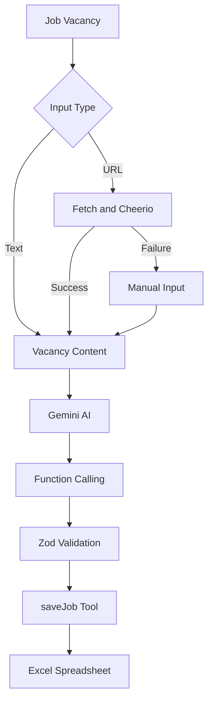

# 🚀 JobPilot AI

> AI-powered job vacancy analyzer and automated Excel tracker.


## 📖 Overview

**JobPilot AI** is an AI-powered CLI application designed to
simplify and automate the job search process.

It analyzes job descriptions from raw text or website URLs,
extracts relevant information using Google Gemini, and
organizes the results into a structured Excel spreadsheet.

The project demonstrates practical LLM integration,
AI Function Calling, structured data extraction,
schema validation, and workflow automation.

---

## ✨ Features

- **AI-powered extraction** — automatically extracts relevant
  information from job descriptions.
- **URL analysis** — retrieves vacancy content directly from
  supported websites.
- **Manual input** — supports multiline job descriptions.
- **Function Calling** — allows Gemini to invoke the
  predefined `saveJob` tool.
- **Schema validation** — validates AI-generated data with Zod.
- **Excel automation** — automatically creates and updates
  spreadsheets.
- **Multilingual support** — processes vacancies written
  in different languages.
- **Fallback mechanism** — switches to manual input when
  webpage retrieval fails.
- **Application tracking** — automatically assigns an initial
  status and creation date.

---

## 🛠️ Tech Stack

| Technology | Purpose |
| :--- | :--- |
| Node.js | Runtime environment |
| TypeScript | Type-safe development |
| Google Gemini API | LLM integration |
| Function Calling | AI-driven tool execution |
| Zod | Schema definition and validation |
| ExcelJS | Excel file generation |
| Cheerio | HTML parsing and content extraction |
| Fetch API | HTTP requests |
| Dotenv | Environment configuration |
| TSX | TypeScript execution |

---

## 🧠 How It Works



The application uses a predefined tool schema to extract
structured information. AI-generated arguments are validated
before being passed to the Excel export function.

---

## 📊 Extracted Data

| Field | Description |
| :--- | :--- |
| Company | Company or product name |
| Position | Complete job title |
| Seniority | Required seniority level |
| Location | Country and city |
| Salary | Compensation details |
| Work Mode | Remote, Hybrid or On-site |
| English | Required English proficiency |
| Experience | Professional experience requirements |
| Contract Type | Employment contract type |
| Technologies | Required and optional technical skills |
| Benefits | Employee benefits |
| Status | Initial application status |
| Date Added | Automatically generated date |
| URL | Original vacancy link, when provided |

---

## 📁 Project Structure

```text
jobpilot-ai/
├── src/
│   ├── index.ts
│   ├── jobSchema.ts
│   ├── getVacancyFromUrl.ts
│   └── saveJob.ts
├── .env.example
├── .gitignore
├── package.json
├── package-lock.json
└── README.md
```

---

## ⚙️ Getting Started

### 1. Clone the repository

```bash
git clone https://github.com/yanakhorolska/jobpilot-ai.git
cd jobpilot-ai
```

### 2. Install dependencies

```bash
npm install
```

### 3. Configure environment variables

Create a `.env` file in the root directory:

```env
GEMINI_API_KEY=your_api_key_here
```

You can obtain an API key from
[Google AI Studio](https://aistudio.google.com/apikey).

> Never commit your API key to a public repository.

---

## 💻 Usage

### Option 1 — Analyze a job description

```bash
npm start
```

Paste the full vacancy description into the terminal.
Type `END` on a new line to start the analysis.

### Option 2 — Analyze a vacancy URL

```bash
npm start -- "https://example.com/job"
```

### Output

The extracted information is automatically saved to:

```text
jobs.xlsx
```

Each new vacancy is added to the existing spreadsheet.

---

## 🔬 AI Engineering Concepts

This project demonstrates the practical application of:

- LLM API integration
- Prompt Engineering
- Function Calling and Tool Use
- Structured Data Extraction
- Schema Validation
- Single Source of Truth
- Automated Workflow Execution
- Error Handling and Fallback Strategies

---

## ⚠️ Limitations

- Some websites restrict automated HTTP requests.
- Dynamically rendered content may require manual input.
- AI-generated information may be incomplete or inaccurate
  and should be reviewed.
- The application currently operates through a CLI.

---

## 👩‍💻 Author

**Yana Khorolska**

Full-Stack Developer | Generative AI & Automation

[GitHub](https://github.com/yanakhorolska)

---

<p align="center">
  Built with TypeScript, Gemini AI and curiosity.
</p>
